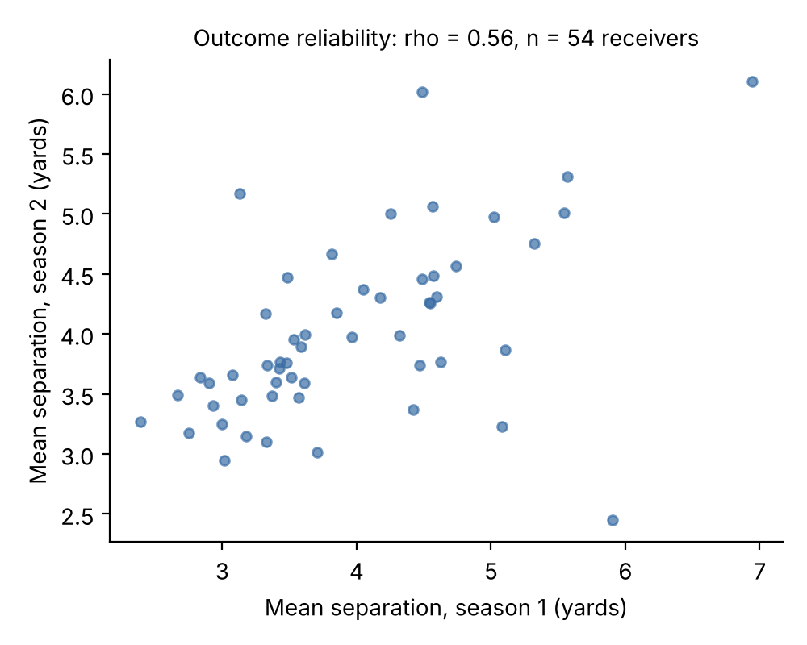
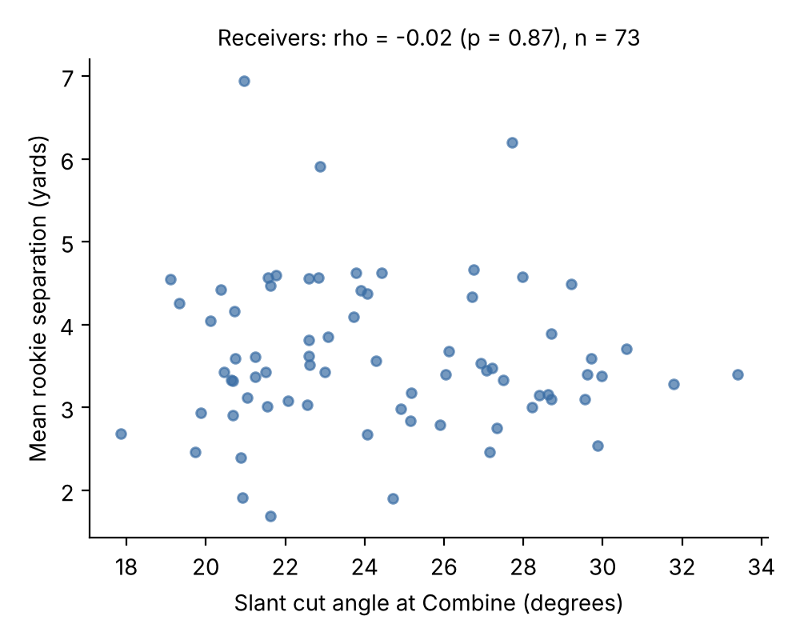
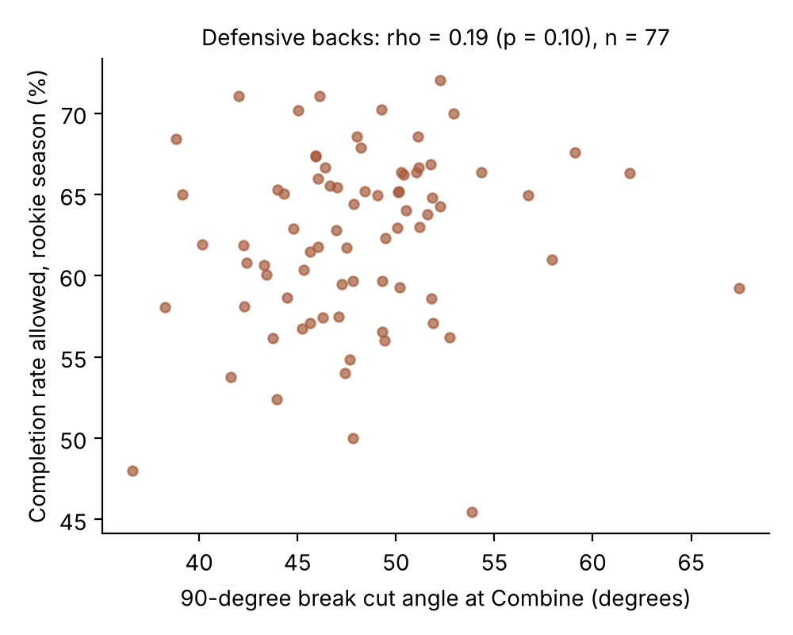
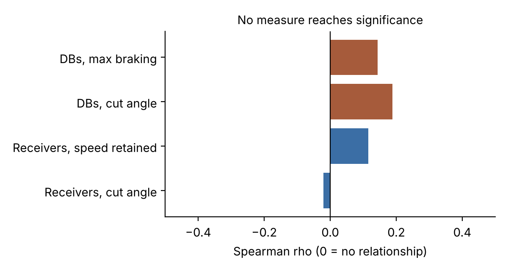

# Do Combine Break Measures Predict NFL Performance? A Negative Result from Player Tracking

*Mohammad Rahman*

## Motivation

Scouts and front offices have long relied on stopwatch drills to judge movement. The 10 Hz tracking data captured at the NFL Scouting Combine records how each prospect moves through a drill, which opens the question of whether the way a receiver cuts or a defensive back breaks says more than a single time does. This writeup asks a narrow question: do break-related movement measures from the Combine predict how a prospect performs in his first regular season? We test two positions, wide receivers and defensive backs, and report the result whether or not it is positive.

## Data

We use the 2027 Big Data Bowl files: Combine tracking and results for 510 prospects from the 2023 to 2025 draft classes, and regular-season tracking and play-level data for 2023 to 2025. Every Combine prospect links to a player record, and the rookie season is the season matching the draft year. Only regular-season games are used.

## Methods

**Combine features.** For receivers we use the slant-route drill (SLANT_ROUTE_LEFT, 107 receivers). For defensive backs we use the 90-degree break to the ball drill (BACK_PEDAL_AND_90_DEGREE_BREAK_TO_BALL, 122 defensive backs). Speed is rebuilt from positions and smoothed over three frames. The break is the frame with the largest heading change while the player moves at 3 m/s or faster. We record cut angle (total heading change around the break), pre-break speed, speed retained one second after the break, and, for defensive backs, braking as the largest deceleration in a one-second window. Where a prospect ran two attempts, we keep the faster one.

**Outcomes.** For receivers, the outcome is mean separation at the pass-forward moment on targets in the rookie regular season. For defensive backs, it is completion rate allowed on covered pass attempts, excluding no-assignment plays. The defensive back outcome is an approximation: a play result while the player was on the field, not a record of the ball he specifically defended.

**Statistics.** We use Spearman rank correlation, a method that does not assume a linear relationship and is less sensitive to outliers than Pearson correlation. We report results across several minimum sample sizes and route sets to check whether conclusions depend on thresholds.

**Outcome reliability.** Before testing features, we checked whether the receiver outcome is stable. Among 54 receivers with at least five regular-season targets in both their first and second seasons, first-season and second-season mean separation correlate at rho = 0.56 (p < 0.001). The outcome therefore carries real signal, though its reliability is moderate, which attenuates any true relationship.

*Figure 1. Each point is one receiver. The outcome is stable enough to test, though not highly reliable.*

## Results

**Receivers (slant-route drill).** Using only slant targets with at least five in the rookie season, 22 receivers qualify. The correlations are close to zero (cut angle rho = 0.04; speed retained rho = -0.03; pre-break speed rho = -0.14), none significant. Pooling all routes gives 66 to 73 receivers and the same picture: every coefficient lies between -0.04 and 0.12, with p-values from 0.33 to 0.92. Restricting to short routes gives the same result.

*Figure 2. Slant cut angle against mean rookie separation on all routes (3+ targets). No visible trend.*

**Defensive backs (90-degree break drill).** Among 77 defensive backs with at least 20 covered pass attempts in the rookie season, cut angle correlates with completion rate allowed at rho = 0.19 (p = 0.10). The sign runs the wrong way for a coaching hypothesis: sharper cuts associate with slightly more completions allowed. Braking (rho = 0.14), speed retained (rho = 0.07) and pre-break speed (rho = -0.10) are also not significant. Raising the threshold to 40 plays, which leaves 65 defensive backs, does not change the picture.

*Figure 3. The sharpest-cutting defensive backs allow no clearly lower completion rate. The one trend runs the wrong way for coaching intuition.*

**Receivers, dagger route: a lead that did not hold.** After the slant and defensive back results, we tested the dagger route, the one receiver drill with a deeper plant and cut. Using speed retained through the break, the first pass gave rho = 0.30 across 73 receivers (p = 0.01). The result was positive across route types, both halves of the rookie targets and the 2023 and 2024 draft classes, and strongest on deep routes (rho = 0.35). We treated it as an exploratory lead, because it followed the earlier nulls and several tests had already been run.

We then checked it with a break rule we fixed before running it: the frame of sharpest braking, rather than the largest heading change. Under that rule the relationship vanished (rho = 0.06, p = 0.61 at three or more targets; rho = 0.14, p = 0.27 at five or more). The result therefore depends on how the break is detected. We withdraw it as a finding.

**Summary.** Across both positions and all thresholds we tested, no Combine break measure predicts rookie performance at conventional significance levels. The one lead we found did not survive a pre-specified check.

*Figure 4. Spearman correlations for the headline tests. No bar reaches significance.*

## Interpretation

We cannot conclude that break movement is irrelevant to NFL performance. We can conclude that, with these measures, these outcomes and these sample sizes, the link is weak at most. Three limitations explain much of this.

First, samples are small. Splitting rookies by position and season leaves 22 to 77 players per test, which can detect only moderate correlations. The outcome's year-to-year reliability of 0.56 also shrinks any true correlation toward zero.

Second, a Combine drill is a controlled movement. In games, separation depends on the quarterback, the play design, the route tree and the coverage scheme, none of which the drill captures. A receiver's slant and his break in a drill are related but different motions.

A further caution comes from the dagger result. A measure that appears to predict performance under one detection rule can disappear under another. Our braking detector is also noisy: in some attempts it selects a near-stop rather than the break. Any break-based measure in this data is therefore sensitive to how the break is defined, and a screen built on one rule would need validating against others before a team used it.

Third, the defensive back outcome is indirect. Completion rate allowed while a player is on the field mixes his coverage with the scheme around him. A cleaner outcome would require target-level attribution, which this data does not provide directly.

## What would change the conclusion

A stronger test would combine more seasons of rookies, use target-level outcomes for defensive backs, and model position and scheme effects explicitly. Two extensions are also worth testing: the receiver three-cone and dagger routes, which add braking, and the defensive back box and transition drills, which measure lateral movement.

## Conclusion

Break-related Combine tracking measures, as we defined them, do not predict rookie-season performance for wide receivers or defensive backs in this data. We present this as a negative result. A well-tested null is more useful to a front office than a fragile positive, because it tells evaluators not to build a screen on these measures without stronger evidence.

## Reproducing the analysis

Place the Kaggle files in `data/`, then run `python analysis/slant_analysis.py data` for the slant results, `python analysis/db_analysis.py data` for the defensive back results and `python analysis/dagger_analysis.py data` for the dagger lead. Full numbers, including the withdrawn break-definition check, are in `FINDINGS.md`.
